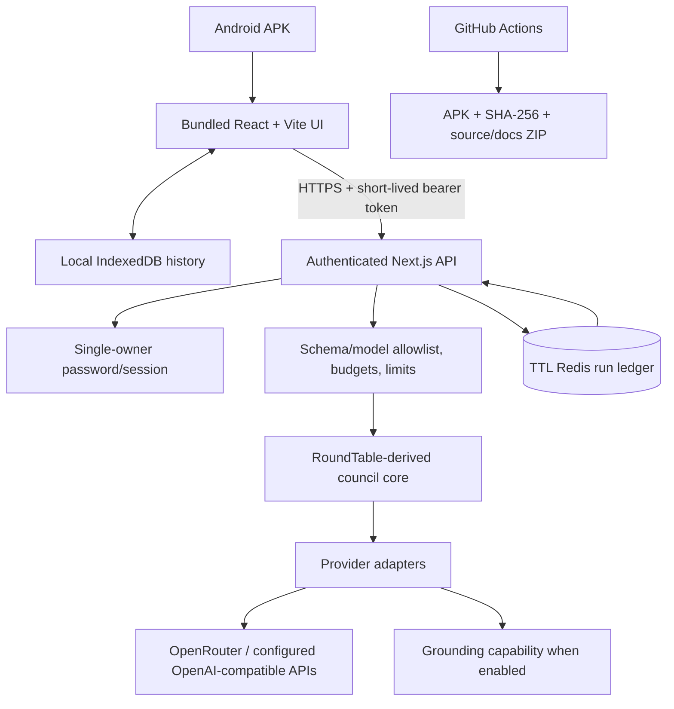

# Master Plan — Private Android AI Council

**Version:** 0.1 proposed baseline · **Research checked:** 23 October 2026 · **Status:** awaiting owner approval · **Implementation:** not started.

## 1. Executive decision

Build a private Android AI council whose interface is bundled in an APK, whose AI requests go through a secured remote backend, and whose history stays on the phone. Use the MIT-licensed `entropyvortex/roundtable` project as the primary code/engine foundation only after reviewing the exact commit, dependencies, license file and tests. Adapt useful workflow ideas from Open Model Council and other projects, but do not merge whole repositories. A benchmark—not the number of connected models—decides whether an addition improves answers.

The system consists of: (1) React/Vite/TypeScript mobile UI packaged with Capacitor; (2) protected Next.js Route Handlers; (3) selectively reused RoundTable council logic; (4) provider adapters with server-side keys; (5) local IndexedDB conversation history; (6) a small TTL-based Redis operational ledger (Upstash is the first free-tier candidate) for active run state, one-time step/idempotency records and rate-limit counters; (7) GitHub Actions for checks, APK build, checksums and full source/docs ZIP. The first backend host candidate is Vercel Hobby for personal/non-commercial use, subject to account eligibility, current plan limits and an actual streaming/API proof-of-concept.

## 2. Constraints to lock

- Android-first, private personal use, no store publication and no public launch.
- All setup/build/test/release steps must be manageable from an Android phone; no local Android Studio or desktop is required.
- Free tools and free hosting within their limits; no card or paid subscription may be silently assumed.
- User already has an API key, but its provider is unspecified. The design supports an allowlisted provider adapter; the exact key type must be tested without revealing it in chat.
- API keys stay in backend environment secrets, never in the APK or client bundle.
- No durable remote conversation-history database/sync in MVP. The backend will temporarily hold minimum active-run context/state in an authenticated Redis store with TTL to enforce run budgets, idempotency and recovery; completed conversation history remains local and explicitly exported by the owner.
- No Replit push-to-GitHub dependency.
- Each major milestone creates complete source/docs ZIP, test report and APK if buildable.
- No public users, revenue model, payments, advertising, public sharing, autonomous tools or store publishing in initial scope.
- Model agreement is not proof of correctness; source evidence and uncertainty must remain visible.

## 3. Problem, vision and value proposition

**Problem:** using separate model tabs is cumbersome; a single model can miss alternatives; council tools can hide dissent, omit source verification, multiply API costs, be desktop-oriented or fail to provide a directly installable APK.

**Vision:** “An evidence-aware AI council in your pocket: compare independent thinking, expose disagreement, verify important claims, and leave with a clear answer plus an honest account of what remains uncertain.”

**Value:** one private Android interface; independent drafts; blinded peer evaluation; controlled debate; adversarial critique; live research/source references when supported; claim-level evidence statuses; cost/call limits; visible partial failures; local history/export; phone-only build management.

**Not the promise:** an unbeatable model, a guarantee of truth, unlimited free inference, offline AI, or professional advice.

## 4. Target user and primary jobs

One mobile-only owner, nontechnical, constrained budget, no desktop, has an API key and wants maximum reasoning quality without juggling websites. Core jobs: answer difficult questions, compare positions, investigate changing facts, stress-test ideas, inspect evidence/dissent, survive provider failures, control cost, and preserve/export sessions.

## 5. Architecture baseline

The APK contains UI assets, not API keys. Provider requests run on the backend. The client requests one bounded step at a time, while the backend/Redis operational ledger validates the approved run plan, preserves required temporary intermediate outputs and prevents replayed steps. Do not run the entire council as one long serverless function. Every API request validates model ID, input size, output tokens, stage, session, timeout and policy limits. Browser state is not trusted for enforcement.

## 6. Main modes

1. **Quick Answer:** one model for simple/low-cost tasks.
2. **Blind Jury:** independent drafts, anonymized/randomized ranking and a separate judge/synthesis.
3. **Consensus Debate (CVP):** independent drafts, targeted critique/revision rounds and explicit convergence/stop reasons.
4. **Adversarial Red Team:** concrete challenge/counterexample, author response and visible unresolved objections.
5. **Research overlay:** provider-supported web grounding, actual source URLs, freshness notes and claim/source checking.
6. **Engine Sweep (later):** same question compared across modes; deferred until basic budget/cancel logic is proven.

## 7. MVP outcome

Owner installs the APK, logs into the private backend, chooses configured models, runs the four primary modes, can enable web grounding where supported, sees streaming stage status, cancels, sees dissent and evidence labels, exports Markdown/JSON, revisits local history, switches theme, and does not exceed configured call/token caps without an explicit opt-in. The owner completes a successful authenticated live provider call on their actual Android phone. A green CI status alone is not acceptance.

## 8. Stack and storage

- Client: React, Vite, TypeScript strict, Tailwind CSS, Zustand, React Router, Zod schemas, Lucide icons, safe Markdown renderer.
- Android: Capacitor; UI bundled inside the APK; build in GitHub Actions using pinned Node/JDK/Android SDK.
- Backend: Next.js App Router Route Handlers, TypeScript, Zod, server-only provider adapters, SSE for individual calls if the host proves reliable.
- Engine: selected RoundTable logic behind a provider-neutral typed interface.
- Primary gateway: OpenRouter initial adapter; add only configured/tested OpenAI-compatible Chat Completions providers.
- Local store: IndexedDB for completed conversation history. Use a minimal TTL-based Redis operational store for active-run state, idempotency and authentication throttling; do not use it as a conversation archive or add cloud-history sync in MVP.
- Host: Vercel Hobby candidate (personal/noncommercial); current limits and SSE behavior must be verified.
- Tests: lint, TypeScript, Vitest, React Testing Library, Playwright, API/security tests and manual Android UAT.
- Source: private GitHub repository preferred; Actions quota is finite on private repos. Public repo is not the default just to get free builds.

Pin exact package versions after the source audit; never blindly copy outdated dependencies from an upstream project.

## 9. Security and privacy

One-owner password and short-lived signed session; keep bearer token in memory only, so restarting the app requires login again. Every model-related API is protected. Provider secrets are host environment variables. Reject arbitrary provider URLs (SSRF risk), client-supplied system prompts and requests above server caps. Logs contain sanitized metadata only, never prompts, outputs, file contents, keys, passwords or tokens. No third-party analytics/crash vendor in MVP. Prompts/files are sent to the selected AI provider and may be routed through its web search service when enabled; disclose this before use. Use OWASP ASVS/API Top 10/MASVS as checklists, not certification claims.

## 10. Key limits

Initial policy defaults: max 4 model seats, up to 2 critique/revision rounds, max 12 completion calls per run, max 4,000 output tokens per call, bounded parallelism, per-call timeout and file-size limits. Values are configurable server-side but cannot be raised by client payloads. A price estimate may be incomplete; unknown-price runs require explicit confirmation. No silent paid-model fallback. The MVP uses a TTL-based server-side operational ledger for run/call/idempotency enforcement. The ledger temporarily stores active-run context and intermediate outputs (not a completed conversation archive), deletes them on completion where practical, and expires them within 24 hours. It still cannot promise an exact monetary cap where provider prices/usage are unknown or a provider bills after cancellation. Enforce hard call/output-token ceilings and estimated cost guards; configure provider-side limits where available.

## 11. Roadmap and exit gates

| Phase | Deliverable | Gate |
|---|---|---|
| 0: plan/source audit | locked docs, repo/dependency/license review, exact provider compatibility plan | no unresolved license/architecture blocker |
| 1: vertical slice | protected backend, health, one provider call, minimal UI and debug APK | real phone installs and completes authenticated request |
| 2: council engines | Blind Jury, CVP and Red Team; progress/cancel/partial failures/budget | mode-specific automated tests pass |
| 3: evidence | grounding/source records/claim ledger/verification labels | fake/missing/stale citation fixtures correctly surfaced |
| 4: product UX | history, search, export/import, notes, theme, accessibility, images/text | storage round-trip and owner UAT pass |
| 5: hardening | dependency/license report, auth/cost/log tests, timeout/device tests | security gates pass |
| 6: private release | stable-signed APK, checksum, source/docs ZIP and recovery guides | owner accepts and safeguards signing key |

Do not promise a calendar duration until the baseline repository and toolchain have passed the feasibility checks. Finish by exit criteria, not by adding features until the schedule collapses.

## 12. Project management

Use lightweight Kanban: Backlog → Ready → In progress → Automated checks → Owner UAT → Done. Each task must include acceptance criteria, security/cost impact and docs/tests to update. `main` remains last known-good; small feature branches for substantial changes; release builds are manual/tag-triggered. Every major milestone produces source/docs ZIP plus checksums and test summary. Changes require a short ADR/change request and updates to affected specifications.

## 13. Definition of done

- Stable APK package ID/signing identity and successful update on actual phone.
- All model routes reject unauthenticated requests.
- No provider keys or session secrets in APK/source/logs/exports/artifacts.
- All four modes, cancellation, retries, partial failures and configured budget limits pass tests.
- Sources are actual returned URLs; unsupported claims remain labelled uncertain/unverified.
- Local history/export/import/delete pass round-trip tests.
- UAT on owner's actual Android device passes; owner can rotate credentials and trigger a new build from phone.
- Release ZIP has source/docs, APK, SHA-256, changelog, test reports and license notices; no `.env`, local database, signing keystore or provider secret.

## 14. Business/market scope

Desk research is for technical selection, not evidence of market demand. This is not a commercial business: monetization is out of scope, and forecast revenue is $0 because no revenue mechanism is planned. Future public/commercial use requires a separate privacy/license/security/business review.
